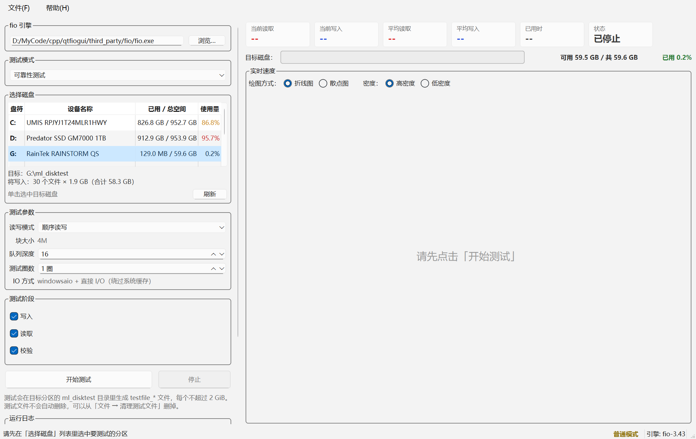
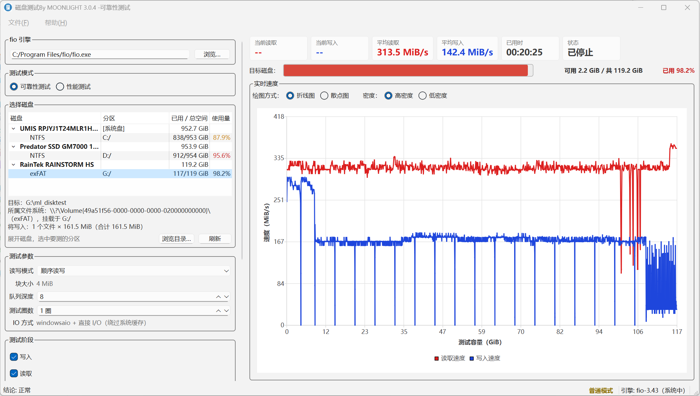
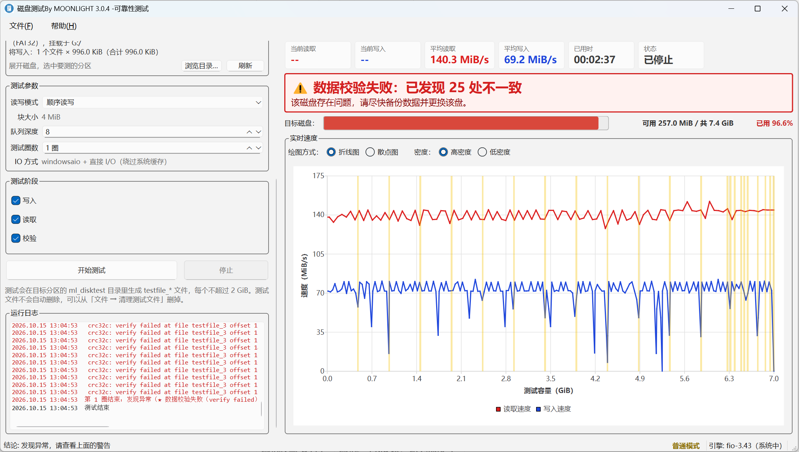
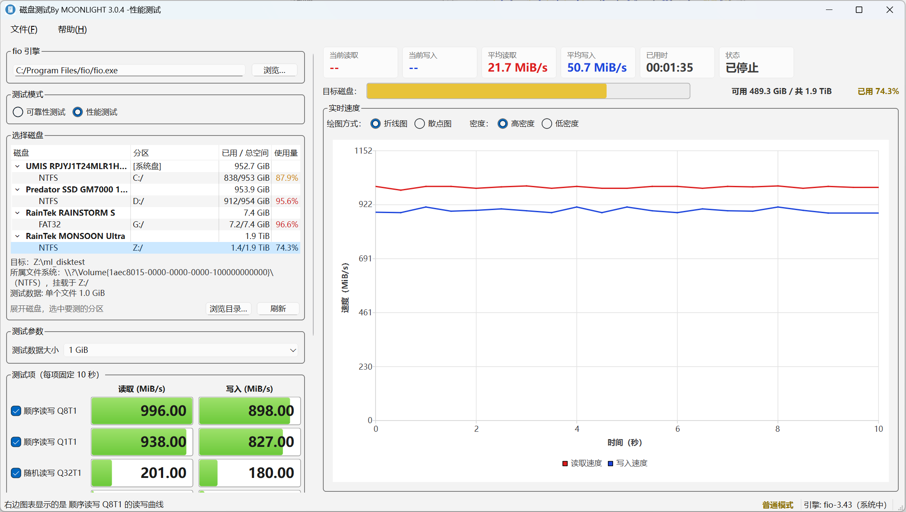
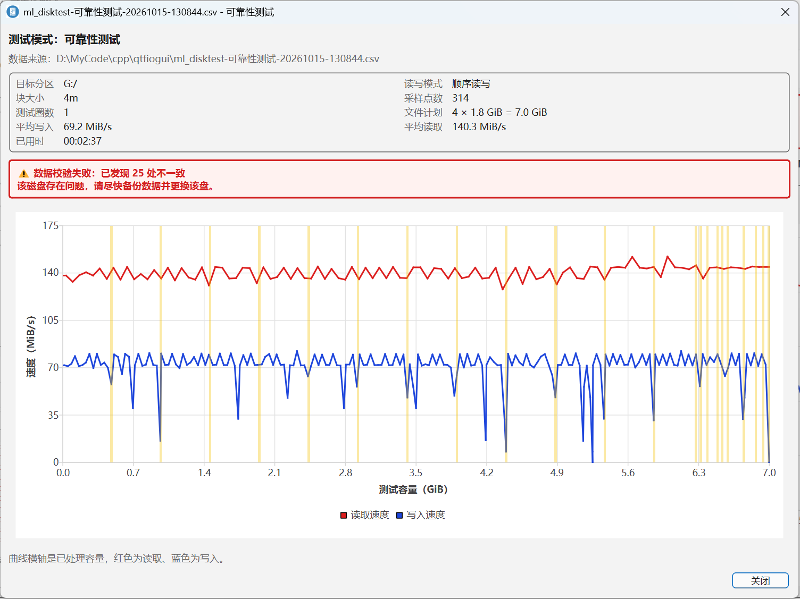

# 硬盘可靠性测试工具

一个带界面的磁盘测试工具：**把选中的分区写满、再读回来逐块校验**，
用来发现坏块、写入失败和静默数据损坏；也可以跑一组标准的读写性能测试。

底层用的是 [fio](https://github.com/axboe/fio)，界面用 C++ / Qt 6 写。



---

## ⚠️ 用之前先看这一段

**这个程序会把目标分区写满，但分区中原始的数据是安全的，前提是磁盘没有损坏。**

- **为了确保安全，尽量不要选系统盘**，也不要选任何存着你还需要的文件的分区。
- 选盘时**看清型号和使用率**。列表按「物理磁盘 → 它上面的文件系统」分成两层：
  展开磁盘、选它下面的那个分区。磁盘那一行只是分组标题，选不了。
- 测试**只会在分区里建 `testfile_*` 文件**，不会去碰物理磁盘的裸设备
  （程序里对 `\\.\PhysicalDriveN`、`/dev/sdX` 这类路径做了硬拦截）。
  但不保证特殊构造的路径可能会让程序判断错误。
- 测试可能**很慢**，慢到要有心理准备：

  | 分区大小 | 大致耗时 |
  | --- | --- |
  | 8 GB（U 盘，约 140 MiB/s） | 写入 ~1 分钟 + 读取 ~1 分钟 |
  | 256 GB（机械盘） | 数小时 |
  | 1 TB（机械盘） | 十几小时 |

  中途可以点「停止」，但已经写进去的文件要等程序下次清理或自己手动删。


---

## 快速开始

1. **下载发布包**：安装版直接运行 `disktest-<版本>-setup.exe`；绿色版解压到任意目录（路径带中文也没问题）。
2. 双击 **`disktest.exe`**（安装版也可以从开始菜单启动）。
3. 如果你的电脑没有安装Qt运行时和fio，那你需要下载全量包，如果环境满足可以只下载本体。
4. 在左侧「选择磁盘」列表里展开一块盘，**单击选中它下面的那个分区**（文件系统）。
   列表里灰色的行表示测不了（只读 / 未挂载 / 没有可写目录）。
5. 点 **「开始测试」**。程序会自动挑一个该分区上的可写目录来放测试文件
   （Linux 上系统盘通常是 `$HOME`，Windows 上通常是盘符根目录），
   也可以自己点「浏览目录…」指定。目标区会写明**会写满哪一个文件系统**。

默认就是最常用的配置，不用改任何参数：

| 项            | 默认值       |
| ------------ | --------- |
| 测试模式         | 可靠性测试     |
| 目标           | **不预选**   |
| 读写模式         | 顺序读写      |
| 队列深度         | 8         |
| 测试圈数         | 1         |
| 写入 / 读取 / 校验 | 全开        |
| 绘图方式 / 密度    | 折线图 / 高密度 |

> 程序**不读也不写任何配置文件**，每次打开都是上面这套默认值。
> 这是故意的：硬盘测试工具的启动状态必须永远确定，不能"上次测了哪个盘、
> 这次一进来就选着哪个盘"。
> （唯一的例外是**界面语言**：选过的语言存在程序目录的 `disktest.ini` 里，
> 免得每次打开都要重新选一遍；那个目录不可写时会改存到 `%APPDATA%\disktest\`。）

### 界面语言

界面有**简体中文 / 繁體中文 / English**三种。第一次启动跟随系统语言
（`zh-TW` / `zh-HK` → 繁體中文，其它非中文系统 → English），
之后可以在 **「帮助 → 语言 / Language」** 里换（会重启一次程序，语言名不翻译，
这样英文界面下也找得到「简体中文」）。命令行也可以强制指定：

```bat
disktest.exe --lang en
disktest.exe --lang zh_TW
```

## 怎么读结果

### 可靠性测试

- **曲线**：横轴是已处理的容量，红线是读取速度、蓝线是写入速度。
  测试文件**一次只打开一个**（fio 的 `openfiles=1`）—— 否则 fio 会把所有测试文件
  同时打开、并行发 IO，盘上同时有好几段在写，低性能磁盘或者机械硬盘可能会导致性能异常。
- **校验失败**：只要有一处数据对不上，图表上方会挂出**大字红色告警**，
  并累计处数。图上每一处坏块还会画一条**黄色背景色带**，一眼能看出坏在哪一段。
- 结论会明确写出来，例如"本次共发现 253 处不一致，该磁盘存在问题，
  请尽快备份数据并更换该盘"。
- 


### 性能测试

依次跑四个固定测试项，每项 10 秒，给出读取/写入吞吐：

| 测试项 | 说明 |
| --- | --- |
| 顺序读写 Q8T1 | 顺序、4 MiB 块、队列深度 8 |
| 顺序读写 Q1T1 | 顺序、4 MiB 块、队列深度 1 |
| 随机读写 Q32T1 | 随机、4 KiB 块、队列深度 32 |
| 随机读写 Q1T1 | 随机、4 KiB 块、队列深度 1 |

结果以"大号数字 + 进度条"显示，点某一项可以单独回看它的读写曲线。



### 保存和回看

- **文件 → 保存测试数据…** 把本次的参数和逐点采样存成 CSV，
  默认存在程序所在目录，文件名带模式和时间戳，
  例如 `ml_disktest-可靠性测试-20261012-183000.csv`。
- **文件 → 打开测试结果…** 在**独立窗口**里回看之前保存的结果，不会动主界面。
  窗口会按数据自身的模式（可靠性 / 性能）渲染。

> 只能打开 **2.2.7 及以后**版本保存的结果。更早的文件缺字段、格式不同，
> 程序会直接提示"版本过旧"。



## 常见问题

**要不要用管理员身份运行？**
不需要。本工具只操作普通文件，不碰裸设备。以管理员（Linux 上是 root）运行时
状态栏会显示"提权模式"，但那是给以后可能支持的裸设备功能留的，文件模式用不到。

**想在 Linux 上测系统盘怎么办？**
不用提权：列表里选中系统盘的那个分区，程序给出的可测目录就是你的家目录
（`$HOME` 和 `/` 在**同一个文件系统**上），写它等于测同一块盘。
容量、"写满"、进度条针对的都是整个文件系统，不是那个目录 —— 界面上会写明这一点。

**程序找不到 fio 引擎？**
发布包里 `fio\fio.exe`（Linux 上是 `fio/fio`）就在主程序旁边，程序会就近找它。
如果你删了它，程序会退回从系统 PATH 里找 `fio`；两处都没有就会明说找不到，
**不会去扫你的硬盘**。

**为什么列表里看不到我的网络驱动器 / 映射盘？**
故意的：网络驱动器（`\\server\share` 映射出来的盘）、内存盘、以及拿不到对应
物理磁盘的映射盘**一律不列**。它们在普通权限下会出现在列表里却一个字节都写不进去
（建目录直接报权限错误），提权之后又会消失 —— 与其让人挑到一个用不了的盘，
不如干脆不列。真要在网络位置上测，用「浏览目录…」直接指定那个目录。
被过滤掉的盘会写在自检报告的 `已忽略的驱动器` 那一行，鼠标放到列表上也能看到。
Linux 上同理：nfs / cifs 不列，但 LVM / 回环这类真的能测的块设备会保留。

**测试中途拔盘 / 断电会怎样？**
测试会失败并报错。已经写进去的 `testfile_*` 留在那个分区上，下次测试时会先清理掉。

**支持哪些文件系统？**
Windows 上 FAT32 / exFAT / NTFS 都实测过；Linux 上 ext4 实测过，xfs / btrfs 同理。
每个测试文件不超过 2 GiB，所以在 FAT32 的 4 GiB 单文件上限下也不会出问题。
需要注意目标文件系统要支持**直接 I/O**（`O_DIRECT`）：`tmpfs`、`ramfs`、
容器里的 `overlayfs` 可能不支持，程序在开测前会先探一次并给出明确提示，
而不是让 fio 抛一句看不懂的 `Operation not supported`。

**这块盘测出来有坏块，还能用吗？**
程序只负责报出来。**发现校验失败就尽快备份数据并更换该盘**——
能刷出静默数据损坏的盘不值得再存东西。

## 从源码构建

需要 C++17 编译器、CMake 3.21+、**Qt 6.2+**（Widgets + Charts），外加一份 fio。

**Windows**：装 Visual Studio（含 C++ 桌面开发负载）+ Qt 6，然后

```bat
build.bat package
```

生成的 `build\dist` 整个目录拷到目标机器双击即可运行。`build.bat help` 有全部用法。
想要**可安装的 `setup.exe`**（开始菜单快捷方式、卸载程序，可选「所有用户 / 仅当前用户」）：

```bat
build.bat installer
```

产物在 `build\installer\disktest-<版本>-setup.exe`，需要 **Inno Setup 6**：

```bat
winget install --id JRSoftware.InnoSetup --exact
```

安装包的内容就是 `build\dist`（exe + Qt 运行库 + fio + 许可证），所以目标机器同样
不需要装 Qt 或 VC++ 运行库。

向导有**简体中文 / 繁體中文 / English** 三种语言，跟随系统语言，也可以强制指定。
静默安装（批量部署用）：

```bat
disktest-3.0.7-setup.exe /VERYSILENT /CURRENTUSER /DIR="D:\Tools\Disktest"
disktest-3.0.7-setup.exe /VERYSILENT /CURRENTUSER /LANG=chinesetraditional
```

**Linux**：

```bash
sudo apt install build-essential cmake ninja-build qt6-base-dev libqt6charts6-dev fio
cmake -S . -B build-linux -G Ninja -DCMAKE_BUILD_TYPE=Release
cmake --build build-linux -j
./build-linux/disktest
```

Linux 上不用自备 fio，发行版装的 `/usr/bin/fio` 就能用。
没有图形界面的机器（服务器 / CI）上跑自检：

```bash
QT_QPA_PLATFORM=offscreen ./build-linux/disktest --selftest \
    --outdir /tmp/st --selftest-target /mnt/testdisk --selftest-fill-limit 200
```

> `--selftest-target` 收的是**目录**：该文件系统上任何一个可写目录都行。
> 想测系统盘就传 `"$HOME"`，不需要 root。

## 许可证

本程序按 **GNU 通用公共许可证第 3 版或任何更高版本**（`GPL-3.0-or-later`）发布，
全文见 [LICENSE](LICENSE)。

```
Copyright (C) 2026 MOONLIGHT

This program is free software: you can redistribute it and/or modify
it under the terms of the GNU General Public License as published by
the Free Software Foundation, either version 3 of the License, or
(at your option) any later version.

This program is distributed in the hope that it will be useful,
but WITHOUT ANY WARRANTY; without even the implied warranty of
MERCHANTABILITY or FITNESS FOR A PARTICULAR PURPOSE.  See the
GNU General Public License for more details.
```

分发的第三方组件与本程序自身的许可证相互独立，详见
[THIRD-PARTY-NOTICES.md](THIRD-PARTY-NOTICES.md)：

| 组件 | 许可证 | 关系 |
| --- | --- | --- |
| Qt 6 | LGPL-3.0 | 动态链接（DLL） |
| fio 3.43 | GPL-2.0 | 独立进程调用，非衍生 |
| MSVC 运行库 | Microsoft 可再分发条款 | 系统级运行库 |
