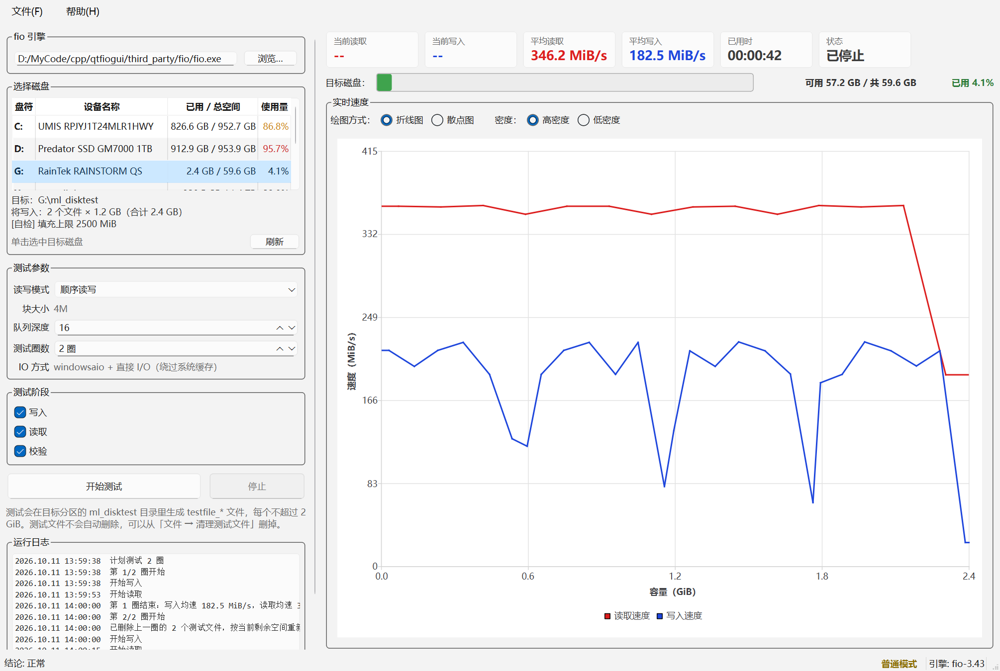
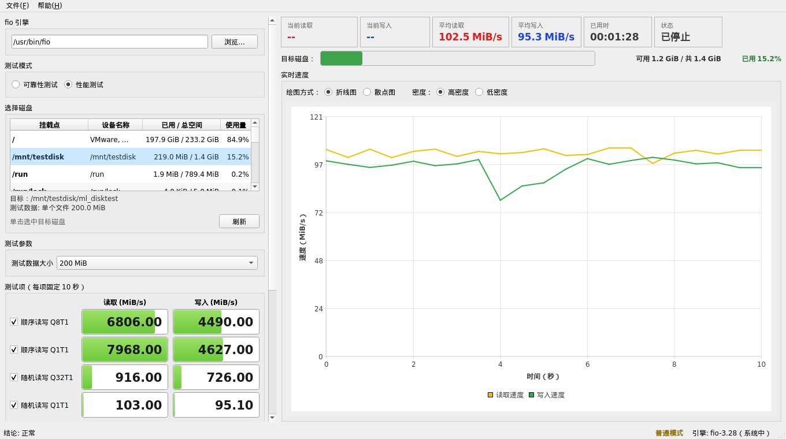

# 硬盘可靠性测试工具 · 技术文档

> **这份是给开发者和想深究原理的人看的**：记的是设计取舍、实测数据和踩过的坑。
> 只想装来用的话，看根目录的 [`README.md`](../README.md) 就够了。

用 **C++ / Qt 6 Widgets + Qt Charts** 写的 fio 图形前端，测试方式是**把选中分区写满、再读回来逐块校验**，
用来发现坏块、写入失败和静默数据损坏。

所有负载都跑在普通文件上，**不碰物理磁盘裸设备**。



---

## 1. 测试流程

1. 在「选择磁盘」列表里展开一块盘，**单击选中它下面的某个文件系统**。
2. 点「开始测试」。程序会：
   1. 算出文件计划：`testfile_0 … testfile_N-1`，每个不超过 **2 GiB**
      （FAT32 单文件上限是 4 GiB，留一半余量最稳）；
   2. **写入阶段**：fio 用 `create_on_open` **边写边建**这些文件，一遍把分区写满；
   3. **读取阶段**：fio 把同样多的字节读一遍，并逐块做 **crc32c 校验**。
3. 结果直接看状态栏和界面上的卡片；「文件 → 清理测试文件」可以删掉这些文件。

### 目标为什么是一个目录，而不是一个分区 / 盘符

**容量和"写满"针对的从来不是"某个挂载点"，而是"某个文件系统"。**
所以同一个文件系统里的**任意一个可写目录**都是等价的：写进去的字节落在同一块设备上，
容量、剩余空间、写满的对象全都一样。程序就是按这个来的 ——
目标是一个**目录**，测试文件建在 `<目标目录>/ml_disktest` 里。

这样做解决的是 Linux 上一个很实际的麻烦：

| | 按挂载点选 | 按目录选 |
| --- | --- | --- |
| 想测系统盘 | 只能选 `/`，而 `/` 通常**只有 root 能写** → 必须 `sudo` 跑整个 GUI | 选 `/home/<你>` 就行，它在同一个文件系统上，**不需要 root** |
| 一个分区挂多处（bind mount / btrfs 子卷） | 会出现好几行，不知道选哪个 | 都一样，随便哪个都行 |
| 挂载点根只读、但下面某个目录可写 | 选不了 | 直接指定那个目录 |

实测（Ubuntu 22.04，普通用户）：

```
/                → /dev/sda1  ext4  233.2 GiB  可写=否
/home/moonlight  → /dev/sda1  ext4  233.2 GiB  可写=是   ← 同一个文件系统
```

所以界面上会这么写，避免"我以为只写自己那个目录"的误会：

```
目标: /home/moonlight/ml_disktest
所属文件系统: /dev/sda1 (ext4), 挂载于 /
⚠ 测试会写满整个 / 文件系统（共 233.2 GiB），不只是上面这个目录
```

- 列表里**只有文件系统那一层可选**：上面那层是物理磁盘（只当分组标题，点了没用），
  测不了的分区（只读、未挂载、没有可写目录）灰掉且不可选。
- 「可测目录」那一列就是程序替你挑好的目录。挑的顺序是
  **挂载点本身 → 用户主目录 → `/var/tmp` → `/tmp`**，每个候选都要
  **真的能建出目录**、而且必须和目标**同属一个文件系统**才算数。
  注意不能用 `QFileInfo::isWritable()` 判断：Windows 上它只看只读属性，
  `C:\` 会被误判成可写，实际 `mkdir` 是 Access denied。
- 都不行就显示「没有可写目录（需要 root）」，你也可以用「浏览目录…」自己指定一个。
- Windows 上是同一套模型：列表按物理磁盘分组、盘符就是它的文件系统，
  自动挑出来的可写目录通常是盘符根目录（系统盘上则是你的用户目录）。

### 横轴是可用空间，不是时间

曲线横轴是**已处理容量**（GB），上限 = 本次测试要用的**可用空间**，
在开测前就定死，之后只往右加点、**不再扩展坐标轴**。写入和读取**各自从 0 开始铺**，
不是首尾相接——两条线叠在同一个容量刻度上，用颜色区分：

```
横轴                : 固定 0 ~ 1.5 GB（按已处理容量）；曲线首点 x=0.0000 GB，末点 x=1.4648 GB
```

横坐标取的是 fio 进程 I/O 计数器的**真实累计字节数**，不是"速度×时间"积分——
积分会因为采样边界慢慢漂移（实测能差 15%，曲线够不到轴右端）。

### 绘图方式与密度

「折线图 / 散点图」是**互斥**的两个选项，放在一起；「密度」是**折线图的子选项**，
排在这两个之后、缩进一格，并且只在折线图下出现（选散点图时整组隐藏）：

```
绘图方式:  (•) 折线图   ( ) 散点图     密度: (•) 高密度  ( ) 低密度
绘图方式:  ( ) 折线图   (•) 散点图                                    ← 密度整组消失
```

互斥用**显式 QButtonGroup** 保证，不是靠"同一个父窗口"这条隐式规则——
后者一旦控件父子关系或插入方式变了就可能失效。互斥组还有个附带好处：
已选中的那个再点也不会被取消，所以**永远恰好有一个被选中**。

自检里对这条有断言（来回切换 + 试图取消选中，每一步都要求恰好一个被选中）：

```
单选互斥（绘图方式/密度）: PASS（任何时刻恰好一个被选中）
```

| 密度 | 折线图 | 散点图 / CSV |
| --- | --- | --- |
| 高密度（默认） | 画全部采样点 | 全部点 / 全量 |
| 低密度 | **按数据量自动抽稀** | **全部点 / 全量** |

低密度的抽稀步长不再固定，而是按实际写入的数据量自动决定：

| 数据量 | 步长 |
| --- | --- |
| < 128 GiB | 每 **3** 个点画 1 个 |
| 128 GiB ~ 1 TiB | 每 **5** 个点画 1 个 |
| ≥ 1 TiB | 每 **10** 个点画 1 个 |

界面上的步长提示已经不显示了（需求：移除低密度提示），分档只影响曲线的疏密。
自检对分档边界有精确断言：

```
折线抽稀步长（自动分档）: PASS
    127 GiB → 每 3 个点画 1 个  OK
    128 GiB（下边界） → 每 5 个点画 1 个  OK
    1023 GiB → 每 5 个点画 1 个  OK
    1 TiB（下边界） → 每 10 个点画 1 个  OK
```

实测同一轮测试：

```
[高密度] 采样点数 21  折线序列=21  散点序列=21   CSV 21 行
[低密度] 采样点数 23  折线序列=8   散点序列=23   CSV 23 行
```

**抽稀只影响画出来的那条折线**，散点图和保存的 CSV 始终是全量数据。
抽稀按"每条序列各自见过的采样数"计数，而不是全过程数组的全局下标——
全局下标会被上一个阶段挤偏，导致本阶段的首点被丢掉，曲线就不再是从头开始了。

**末点一定保留**，但**要显式说一声**：抽稀规则是"每隔 step 个点保留一个"，
末点落在哪一格是偶然的——不是 step 的整数倍时就被抽掉了，曲线末端于是够不到
横轴右边缘。所以凡是"一次性把一批数据灌进图表"的地方（打开 CSV 结果、
重画某一项的曲线）加完点都要调 `SpeedChart::finishSamples()`，
它按当前步长重建折线，而 `rebuildLineSeries()` 里有对末点的专门保留逻辑。

> 这里踩过两个坑，表现都是"**保存回看时最后一个点缺失**"：
> 1. **性能数据根本没把末点存下来**。10 秒窗口最后一拍是 9.5 秒，收尾那个
>    10.0 秒的补点只加进了实时图表和内存轨迹，**没写进存档数组**，
>    所以 CSV 里每趟都停在 `t=9.51`，图上却画到 10.0。现在三份数据一起补。
> 2. **回看时末点被抽稀吃掉**。同一份数据在实时图上末尾是齐的（因为实时是
>    逐拍追加，末尾那拍不参与抽稀判定），换成一次性灌入就露馅了。

### 停止与结束时的显示

- **中途停止**：一旦按下「停止」就不再接收任何采样点，曲线**停在按下那一刻**，
  既不会被收尾那一拍拉动，也不会被"补到阶段终点"的闭合点拖到横轴末尾——
  只有正常跑完的阶段才补终点。
- **测试结束**：实时速度清零（「当前读取 / 当前写入」显示 `--`），
  只保留「平均读取 / 平均写入」。收尾时不会留下最后一个瞬时读数冒充结果。
  加载历史 CSV 时同理。

```
停止的曲线  : 横轴 固定 0 ~ 2.9 GB；曲线末点 x=0.5586 GB     ← 停在中途
结束时卡片  : 当前读=--  当前写=--  平均读=345.4 MiB/s  平均写=190.5 MiB/s
```

### 中途停止时会做什么

| 停在哪 | 结果 | 为什么 |
| --- | --- | --- |
| **写入阶段** | **删掉测试文件** | 盘上是写到一半的数据；随机模式下还有根本没写过的洞。留着它，下次只读校验必然报出一堆假坏块（校验头对不上）。删干净后测试目录为空，只读自然也点不了。 |
| **只读校验** | **什么都不动** | 停止前后的勾选状态保持一致，免得用户以为自己没点过什么、选项却变了。 |

```
[写一半停] 结束时勾选 : 写入=1  读取=1  校验=1     G:\ml_disktest 文件数 = 0
[只读被停] 结束时勾选 : 写入=0  读取=1  校验=1
```

### 写入前的准备顺序

「开始测试」时的顺序是 **先删旧文件 → 再量剩余空间 → 最后算文件计划**：

```
1. 确认是否覆盖（见下）
2. 删除测试目录里旧的 testfile_*
3. 重新查询分区剩余空间      ← 必须在这时候量
4. 按新的剩余空间算文件计划
```

**为什么顺序不能反**：旧文件还占着空间时量到的剩余量是偏小的。先算计划再删文件，
就会出现"删完之后明明空出一大片，却还按旧计划写"的情况，实际写入量远小于分区可用空间；
极端情况下（上次跑满了整块盘）旧文件占满空间，剩余量只够安全余量，第二次点击开始
会直接报「空间不足」——其实删掉旧文件就有空间了。

实测（G: 上先放 26 个共 52 GB 的旧文件，剩余只剩 9,031 MiB）：

```
删除前算 → 目标 7,810 MiB  → 计划约 4 个文件 ≈ 7.6 GB   ← 错的
删除后算 → 目标 12,000 MiB → 计划 6 个 × 2.0 GB = 11.7 GB  ← 现在的结果
```

### 写入前会确认是否覆盖旧数据

勾上「写入」时，如果目标分区的测试目录里已经有 `testfile_*`，会先弹一个确认框
（**默认按钮是「取消」**）：

```
目标分区里已有测试文件
目标分区 G:\ml_disktest 的测试目录里已经有 30 个测试文件，合计 58.0 GB。
继续写入会先删除这些旧文件，再重新完整写一遍。
确定继续吗？            [继续] [取消]
```

- 点「取消」→ 把「写入」的勾去掉，什么都不会删。
- 点「继续」→ 记住这个目录，本次不再重复问。
- 点「开始测试」时**还会再兜一道**：进入测试前统一核对一次，不加这一道就可能
  在用户毫不知情的情况下删掉旧数据。
- 换目标分区、或一轮测试跑完后，确认状态重置。
- **自检模式（`--selftest`）不弹任何框**，否则自动化会被卡住。

### 两个读写模式

两个模式都是**先写满、再读回**，区别只在块大小和顺序/随机：

| 模式 | 块大小 | 写入阶段 | 读取阶段 |
| --- | --- | --- | --- |
| 顺序读写 | **4M** | `rw=write` 顺序写满 | `rw=read` 顺序读回 |
| 随机读写 | **4K** | `rw=randwrite` 随机写满 | `rw=randread` 随机读回 |

块大小由模式决定，不再单独设置。读取阶段永远是**纯读**，
所以状态只会有「准备中 / 正在写入 / 正在读取 / 已停止」四种。

### 每个阶段的第 1 个采样点会被丢掉，但曲线仍从 0 开始

每个阶段刚开始的那一拍，覆盖的是 fio 启动、建文件、缓存预热的开销，
画出来是一根扎到底的假谷底，还会把平均值拉低。所以测试**直接丢弃每阶段的第 1 拍**
（`忽略的首拍: 2 个`），不进统计。

但那一拍在容量轴上实打实占掉了一段（约 2%），直接丢掉会让曲线看起来不是从头开始。
所以第 2 拍到达时，会在**容量 0 处补一个"起点锚"**：横坐标 0，速率用第 2 拍的
（被丢掉的第 1 拍速率本来就不可信），时长为 0 因而不参与平均值加权。

效果（同一块盘，1.5 GB 顺序读写）：

| | 修正前 | 只丢首拍 | 现在 |
| --- | --- | --- | --- |
| 写入 min | ~50 MiB/s | **192 MiB/s** | 192 MiB/s |
| 读取 min | ~145 MiB/s | **384 MiB/s** | 384 MiB/s |
| 曲线起点 | 0 | 约容量的 2% | **0** |

### 三个勾选框

- **写入：把分区写满**（默认勾选）
- **读取：写满后读回**（默认勾选）
- **校验数据（crc32c 逐块比对）**（默认勾选）

只勾「读取」时会直接读现成的测试文件——**但前提是盘上已经有测试文件**，
没有的话「读取」会被自动取消勾选（工具提示会说明原因）。这正好支持
"上次写到一半、这次只想重新校验一遍"的用法。

### 测试圈数

「测试圈数」把整轮测试重复几遍，与勾选的阶段联动：

| 勾选 | 每一圈做什么 | 圈与圈之间 |
| --- | --- | --- |
| 写入 + 读取 | 写满 → 读回校验 | 删掉测试文件，重新量剩余空间、重新规划，再来一遍 |
| 只勾写入 | 写满 | 同上 |
| 只勾读取 | 读回校验 | **不删文件**，只是把校验重复几遍 |

**每一圈都是独立的一轮**：图表、统计、曲线方向都从头开始，所以屏幕上看到的是当前那一圈。
每一圈结束会在运行日志里留一行小结（`第 2 圈结束：写入均速 207.9 MiB/s，读取均速 346.7 MiB/s`），
最终报告里每个阶段块也会带上圈号：

```
测试圈数            : 3
--- 第 1 圈 · 写入阶段 ---
--- 第 1 圈 · 读取阶段 ---
--- 第 2 圈 · 写入阶段 ---
...
```

覆盖确认只在第 1 圈问一次——第 2 圈之后的文件是这个测试自己刚写出来的，没必要反复问。

### 运行日志

左侧面板下方是运行日志，按时间顺序记录做过什么，**出错用红字**：

```
2026.10.11 13:58:23  计划测试 2 圈
2026.10.11 13:58:23  第 1/2 圈开始
2026.10.11 13:58:23  开始写入
2026.10.11 13:58:38  第 1 圈结束：写入均速 182.5 MiB/s，读取均速 345.7 MiB/s
2026.10.11 13:58:45  第 2/2 圈开始
2026.10.11 13:58:45  已删除上一圈的 2 个测试文件，按当前剩余空间重新规划
2026.10.11 13:59:05  全部 2 圈测试结束
2026.10.11 14:00:50  错误：找不到目标分区：自检指定的是 Q:。      ← 红色
```

调试输出（fio 的原始 stdout/stderr）仍然只进「文件 → 保存诊断输出」，
不会刷到日志面板里——面板里只有"人看得懂的事件"。
日志最多保留 2000 行，长时间跑不会无限涨。

### 磁盘进度条

图表上方是一条**按占用率变色的圆角进度条**（<70% 绿 / 70~85% 黄 / 85~95% 橙 / ≥95% 红），
右侧两列**定宽右对齐**的读数，刷新时数字不会左右跳动：

```
目标分区：[████████░░░░░░░░░░░░░░]   可用 58.1 GB / 共 59.6 GB   已用 2.5%
```

### 权限提示

状态栏右下角显示当前进程的权限：**提权模式**（绿）或**普通模式**（黄），
鼠标悬停有说明。它查的是 Windows 令牌的 `TokenElevation`，不是"用户名在管理员组里"。

### 窗口与「关于」

- 标题栏：`硬盘可靠性测试工具 v2.0.0`
- 「帮助 → 关于」：版本、作者、联系作者、**编译时间**、构建环境（Qt 版本 /
  提权或普通模式），下面接测试流程说明。
- 版本号只有 **`CMakeLists.txt` 里 `project(... VERSION x.y.z)` 一个来源**，
  编译期以 `QTFIOGUI_VERSION` 宏传进代码，标题栏和「关于」都取自它，改一处即可。
- 作者与联系方式是 `src/uitext.h` 顶部的 `kAuthor` / `kContact`，
  **默认是占位符，请改成你自己的**。

### 保存 / 打开测试结果

「文件 → 保存测试数据…」把本次运行的**参数和全部逐点采样**存成一个 CSV；
「文件 → 打开测试结果…」**在一个独立窗口里**把它读回来显示（不跑测试、不动主界面）。

保存对话框**默认落在程序自己所在的目录**（`<exe目录>\ml_disktest-data.csv`），
不是被测盘。以前默认存到 `<目标分区>\ml_disktest\` 里，有三个问题：

1. 结果写在被测盘上，占那块盘的空间——大盘一测就占满，想把结果存下来反而先失败；
2. 它躺在 fio 的测试目录里、和 `testfile_*` 混在一起，
   下次「清理测试文件」或重跑会把结果当垃圾一起删掉；
3. 盘测完要拔下来时，结果还留在上面，容易连盘一起交出去。

**为什么用独立窗口**：历史数据可能来自一块当前机器上根本不存在的盘（比如昨天插的 G:）。
灌进主界面的话，卡片、磁盘进度条、「目标分区」显示的都是"当前选中的盘"，
和数据来源对不上，还得为此加一堆"加载来的数据"状态。独立窗口天然没有这个问题。

窗口按**数据自身的模式**渲染：

| 数据 | 横轴 | 内容 |
| --- | --- | --- |
| 可靠性 | 已处理容量（GiB） | 读写双线图（读红 / 写蓝）+ 摘要行 |
| 性能 | 时间（秒），0 ~ 10 | 四项结果表（大号数字 + 绿色进度条），点某一项单独回看它的读写曲线 |

保存对话框默认文件名带模式和时间戳：
`ml_disktest-可靠性测试-20261012-183000.csv` / `ml_disktest-性能测试-20261012-184500.csv`。
一次会话两种模式可能都跑过，都叫 `ml_disktest-data.csv` 会互相覆盖，
隔几天再看也分不清是哪次的结果。

CSV 分两段，用 `# [run]` / `# [samples]` 标记：

```
# ml_disktest-run-data;1
# [run]
app_version,2.2.7
test_mode,reliability
mode,顺序读写
target,G:/
block_size,4m
iodepth,8
axis_max_GiB,58.407598
plot_style,line
density,low
write_exit_code,0
write_avg_write_MiBps,180.775
read_avg_read_MiBps,356.436
# [samples]
read_GiB,read_MiBps,has_read,write_GiB,write_MiBps,has_write,duration_sec,item,pass
0.000000,0.000,0,0.000000,64.000,1,0.500,0,0
...
```

#### 版本门槛：2.2.7 之前的文件一律不给打开

`app_version` 记录的是**写这份结果的程序版本**。打开时按它判断：

| 文件版本 | 结果 |
| --- | --- |
| ≥ 2.2.7 | 正常打开 |
| < 2.2.7 | 拒收，提示"版本过旧，请用当前版本重新测试并保存" |
| **没写** `app_version` | 同上（2.2.7 之前存的文件都不写版本号） |

**为什么干脆不做兼容**：结果格式在 2.2.7 这一版改动很大——`test_mode`、
`item,pass`、坏块信息、逐文件大小、`file_sizes` 都是新加的。老文件缺这些字段时
只能靠猜，猜出来的图**看着正常、位置和内容却是错的**，比明说"不支持"更坑人。
所以读取端删掉了老格式的兼容分支，只认一种格式。

> 这一条连自己都咬到过：可靠性数据的写入端当时还在写 **7 列**表头，
> 而读取端只认 9 列，于是"当前版本存的可靠性结果读回来是 0 个采样点"。
> 现在两种模式的采样段**统一 9 列**（可靠性没有分项概念，`item,pass` 固定写 `0,0`）。

**`test_mode` 是模式判别的依据**（`reliability` / `performance`）。
没有这一行时退回按性能专属键（`perf_items` / `perf_data_bytes`）判断，
再没有就按可靠性——不过这种文件已经被版本门槛挡掉了，这条兜底路径实际走不到。

`item,pass` 两列用来还原"这一拍属于哪一项、哪一趟"：

| 列 | 含义 |
| --- | --- |
| `item` | 测试项下标 0~3，顺序同 `FioConfig::allPerfItems()`；可靠性数据固定 0 |
| `pass` | `0` = 读取趟，`1` = 写入趟；可靠性数据固定 0 |

性能数据的横轴是时间，所以 `read_GiB` / `write_GiB` 两列里装的是**秒**，
轴按 `test_mode` 换成时间轴来画。四项的整趟结果另外记在参数段
（`seq_q8t1_read_MiBps`、`seq_q8t1_write_MiBps` …），
结果表里的数字取的就是它们，和实时界面格子里的数一致。

#### 坏块信息也在文件里

参数段还会记下这次校验的结果，加载时就能直接看到"这块盘当时坏没坏"：

```
verify_failures,253
verify_text,crc32c: verify failed at file testfile_3 offset 255852544, length 4194304|...
verify_offsets,255852544|373293056|...
verify_file_index,3|1|...
file_sizes,1891887104 1891887104 1891887104 1891887104
```

| 参数 | 含义 |
| --- | --- |
| `verify_failures` | 校验失败的块数（0 = 没发现不一致） |
| `verify_text` | 逐处的 fio 原话，`\|` 分隔 |
| `verify_offsets` | 逐处的**文件内**字节偏移，`\|` 分隔，与上面一一对应 |
| `verify_file_index` | 逐处所在的**文件序号**（`testfile_N` 的 N），同上 |
| `file_sizes` | 逐文件大小（字节），**空格**分隔 |

`verify_*` 三条里的逐处列表都用 `|` 而不是逗号——fio 的原话里本来就有逗号。
逐处明细上限 1000 条（一份坏盘记录能上千条），**统计数字不受这个上限影响**。

打开结果窗口时，这些信息显示成一条红框——**和实时图表上那条一字不差**
（用的是同一组文案常量 `kVerifyBannerHead` + `kVerifyBannerNote`；
同一件事在两个地方用两套措辞，用户会以为是两回事）：

```
⚠ 数据校验失败：已发现 253 处不一致
该磁盘存在问题，请尽快备份数据并更换该盘。
```

坏在哪由两方面给出：图上每处一条黄色色带，窗口外的运行日志里有逐处明细。
红框里不再单列"首处偏移量"——那是日志的活。

**没有坏块信息时**（这次测试一处不一致都没发现），读出来就是"0 处、无明细"，
窗口**不显示红框**——不能凭空报红。

加载时会一并还原横轴上限、绘图方式和密度。实测同一份 CSV 存了再读，
采样点数、横轴、末点完全一致：

```
存: 横轴 固定 0 ~ 1.5 GB；曲线首点 x=0.0000 GB，末点 x=1.4648 GB
读: 横轴 固定 0 ~ 1.5 GB；曲线首点 x=0.0000 GB，末点 x=1.4648 GB   加载数据 PASS（25 个采样点）
```

CSV 里存的是**整轮**（写入 + 读取）的数据，不是只有最后一个阶段。
性能数据同样是整轮：四个测试项、每项读写两趟，一共 8 趟全在里面
（主图表每换一项就 `clear()`，所以另有一份只增不改的整轮数组专门用来存档）。

窗口里的**平均值直接取文件里记录的分阶段平均值**，不拿采样点重算：

| 摘要项 | 取自 CSV 的 |
| --- | --- |
| 平均顺序读取 | `read_avg_read_MiBps` |
| 平均顺序写入 | `write_avg_write_MiBps` |
| 已用时 | `write_elapsed_sec + read_elapsed_sec` |

> 性能结果里的"平均顺序读/写"**统计的是整轮采样**，四项（顺序 Q8T1 / 顺序 Q1T1 /
> 随机 Q32T1 / 随机 Q1T1）的采样都算在里面，所以它落在顺序项和随机项之间。
> 单项的准确结果看下面那张结果表。

**摘要区按模式排两套**，两种测试关心的东西不一样：

```
性能                                    可靠性
目标分区  平均顺序写入  平均顺序读取      目标分区  读写模式
测试数据  已用时                        块大小    采样点数
                                        测试圈数  文件计划
                                        平均写入  平均读取
                                        已用时
```

性能结果里**不显示**读写模式、块大小、采样点数：性能测试的读写模式由测试项决定
（顺序项就是顺序、随机项就是随机），笼统写一个"顺序读写"反而误导；块大小同理
（4M 与 4K 混在一起）；采样点数属于诊断信息，不是结果。

**为什么不能重算**：写入阶段和读取阶段的速度能差两三倍（写入 ~156 MiB/s、
读取 ~357 MiB/s），把两段的采样点混在一起平均出来的数既没有物理意义，
也和保存时卡片上显示的数字对不上。实测一份 58 GB 的记录：

```
文件里记录: write_avg_write=155.811  read_avg_read=357.157  elapsed=381.5+166.5
重算会得到: 平均读=108.6  平均写=108.3        ← 错
现在显示  : 平均读=357.2 MiB/s  平均写=155.8 MiB/s  已用时=00:09:08   ← 对
```

老版本存的 CSV 没有这几项，那种情况才退回用采样点现算。

解析规则本身有独立的纯逻辑自检（不开窗口、不碰磁盘、不跑 fio）：

```
build\qtfiogui.exe --selftest-parse
```

它覆盖：性能格式、老格式兼容、`item/pass` 归位、分阶段平均值取值、
性能专属键兜底判据、损坏文件被拒。

---

## 2. 校验是怎么做的

写入阶段用 `--verify=crc32c --do_verify=0`：把校验和写进每个块的头部，
但**不做即时校验**（默认 fio 会写完一块立刻读回来比对，那会把写入阶段变成读写混在一起、
写入速度也会腰斩）。校验留到读取阶段统一做：读取阶段带 `--verify=crc32c`，
按块比对头部里的校验和。

**跨两次 fio 调用能校验成功**，因为校验和就在数据里，不依赖内存状态。
实测人为破坏一个块之后：

```
fio 退出码        : 1
job err           : 42
告警              : 2
  - ★ 数据校验失败：块的校验头不匹配，磁盘上的内容与写入时不一致
  - ★ I/O 返回非法字节序列，通常是校验不一致 × 2
```

### 遇到校验失败要读完，不要停

fio 默认在**第一次**校验失败时就结束这个 job。对可靠性测试来说这是错的：
一块坏块就把整轮读取终止，剩下的区域是好是坏完全不知道，
而"这个分区里到底有几块坏的、都在哪"恰恰是这类测试唯一要回答的问题。

所以读取阶段额外带 `--continue_on_error=verify`：

| 取值 | 含义 |
| --- | --- |
| `none`（fio 默认） | 任何 I/O 或校验错误都退出 |
| **`verify`** | **只对校验错误继续，其它错误照旧退出** |
| `all` | 所有错误都继续 |

选 `verify` 而不是 `all` 是故意的：真正的 I/O 错误（掉盘、超时）仍然应该立刻停下，
只有"数据对不上"才继续——那正是我们要统计的东西。

实测在一块有坏块的 7.4 GiB U 盘（G:，FAT32）上跑满盘顺序读写：

```
读取阶段
  fio 汇总 读取     : 170.0 MiB/s  io=7136MiB (7483MB), run=42053-42053msec
  job err           : 42
  告警              : 3
  校验失败块数      : 165
  首处失败原话      : crc32c: verify failed at file testfile_1 offset 205520896, length 4194304
```

`io=7136MiB` 说明**整个分区读完了**（曲线也一直画到横轴 7.0 GiB 的右边缘），
同时统计出 165 处不一致并给出第一处的偏移量。
同一块盘两次跑分别得到 926 处和 165 处，数量每次都不一样——这正是坏盘的典型表现。

### 校验失败在界面上怎么显示

测试阶段只要 fio 报出一块不一致，右侧图表区上方就会挂出一条**大字红色告警**，
实时累加处数；下面只写一句结论和该做什么：

```
⚠ 数据校验失败：已发现 165 处不一致
该磁盘存在问题，请尽快备份数据并更换该盘。
```

同时每一处都写一行到运行日志（红字，带各自的偏移量），状态栏也显示累计处数。
阶段结束时日志里再给一次总数加逐处明细：

```
★ 本阶段共发现 944 处数据校验失败
  crc32c: verify failed at file testfile_2 offset 4194304, length 4194304
  crc32c: verify failed at file testfile_2 offset 8388608, length 4194304
  crc32c: verify failed at file testfile_1 offset 20971520, length 4194304
  ...
```

### 坏块在图表上怎么标

每个坏块的位置在图里画成一条**黄色半透明背景色带**，从纵轴底一直拉到顶。
（色带是画在图表背景上的一层，不属于任何序列，所以它进不了图例；
也就不在图下另加说明文字了——红色告警条已经写明"发现了多少处、这块盘有问题"。）

横坐标要这么换算，因为 fio 给的是"**第几个文件**里的**第几字节**"，而图表横轴是"已处理容量"：

```
全局字节 = Σ(前 fileIndex 个文件的大小) + 文件内偏移
横坐标   = 全局字节 / 1 GiB
```

**两处都不能省**：

> ⚠️ **文件序号**：fio 只报文件内偏移，而且**每个文件都从 0 开始报**
> （`testfile_0` 的 256 MiB 和 `testfile_3` 的 256 MiB 是两个完全不同的盘上位置）。
> 这个坑真的踩过：一开始只拿偏移当位置用，结果 200 多处坏块全被画到
> **0.24 ~ 1.43 GiB** 这一小段里（因为收集到的偏移都不超过单文件大小），
> 看着就像"坏块全在盘的最前面"。补上文件序号之后同一份数据变成
> **0.36 ~ 6.96 GiB** 铺满全盘，和 fio 日志里 4 个文件都有坏块的分布对得上。

> ⚠️ **逐文件大小**：不能拿一个统一的"单文件大小"去乘序号——
> **只读校验用的是盘上现成的文件**，它们不一定等大（可能是上一轮用别的
> 测试数据尺寸留下的）。所以 CSV 里记的是 `file_sizes` **列表**，
> 换算时累加序号之前的那些文件。另外这条路径不经过 `planFiles()`，
> 曾经因此漏掉赋值，坏块又挤回图的最前面一次。
>
> 还有个小坑：`file_sizes` 是**数字列表用空格分**，而 `verify_offsets` /
> `verify_text` 是**用 `|` 分**（因为 fio 原话自带逗号）。两者分隔符不同，
> 解析时别弄混——混了会一个都解析不出来，位置全按"第一个文件"算。

实测那块 7.4 GiB 的坏 U 盘（4 个 1.76 GiB 测试文件），200 处坏块的分布：

```
0~1 GiB:   3      3~4 GiB:  89      6~7 GiB:  52
1~2 GiB:  27      4~5 GiB:  25
2~3 GiB:   2      5~6 GiB:   2
```

**为什么是"背景色带"而不是"竖线"**：先试过用 `QLineSeries` 画竖线，踩了两个坑——

1. 把所有标记塞进**一条**序列，Qt Charts 会把它当折线连着画：
   第 N 条的顶端连到第 N+1 条的底端，屏幕上就是一片头尾相连的斜线。
2. 改成**每处一条**独立序列能避免连线，但 `QChart` 只有 `addSeries()`，
   没有"插到曲线下面"的接口，几百条序列也只能盖在数据点上面。

最后的做法是在 `QChartView` 的派生类里，**等基类画完图表之后**再刷一层
半透明黄色矩形（见 `VerifyBandChartView`）：

| 做法 | 结果 |
| --- | --- |
| 基类**之前**画 | 被 `QGraphicsView::paintEvent` 刷背景时整个擦掉，画了看不见 |
| 基类**之后**画 | 保得住，而且因为是半透明，**曲线和数据点照常透出来** |

半透明是关键：色带压在曲线上，但红蓝曲线和散点透过它一样看得清，
所以既不遮挡读数，又能把"坏在哪一段"标出来。

**关于"不能糊成一片"**：一条色带只占 3 像素宽，同一处堆再多条也还是一个色块，
所以按"屏幕上还分不分得出是两条"去重（间距小于 4 像素就并成一条，
上限 200 条）——**告警条上的处数、日志里的逐处明细都是完整数字，不受这个去重影响**。

> **这里踩过一个坑**：原来界面每次都拿 `m_firstVerifyError` 去记日志，
> 于是日志里上百行全是**同一个偏移量**，看起来像"这块盘只在那一处坏"。
> 实际数据一直是好的——一次实测里 fio 报了 588 行、去重后 **147 个不同的偏移量**，
> 纯粹是渲染时重复了第一条。现在逐处上报各自的原话，
> 并把去重后的明细（上限 200 条，统计数字不受影响）一起写进日志和 `selftest.log`。

**这一条不用弹窗**。一块坏盘能刷出成百上千条校验失败，弹一个千行模态框
只会把上面那条告警整个盖住，还会让无人值守的测试卡在那里等人点确定。
其它告警（打不开文件、空间不足、非法选项…）仍然照旧弹窗——
那些是"测试本身没跑对"，不看会误判结果。

### 随机模式能覆盖每一个块吗

能。fio 默认维护一张"随机表"（`norandommap` 关闭时），在偏移用完之前不会重复，
所以 `randwrite` 写 `size = 文件总大小` 的字节数，正好把每个块各写一次。
实测：随机写一遍 24 MiB 之后随机读回校验，`err= 0`、没有任何 `bad magic header`。

---

## 3. 文件规划：为什么每个文件是 2 GiB 以内

`planFiles()` 按剩余空间算：

```
目标 = 剩余空间 − 安全余量            （安全余量 = 2%，夹在 256 MiB ~ 2 GiB 之间）
文件数 = ceil(目标 / 2 GiB)
每文件大小 = 目标 / 文件数            （向下取整，所以每个都 ≤ 2 GiB）
```

均分而不是"若干个 2 GiB + 一个零头"，是因为 fio 的 `filename_format`
没法给单个文件指定不同大小，均分最省事也最不容易出错。

自检里对这条逻辑有独立断言（摘掉自检用的填充上限之后跑）：

```
剩余 2.0 GB   → 1 个 × 1.8 GB   = 1.8 GB    OK
剩余 5.0 GB   → 3 个 × 1.6 GB   = 4.7 GB    OK
剩余 900.0 GB → 449 个 × 2.0 GB = 898.0 GB  OK
剩余 300.0 MB → 1 个 × 44.0 MB  = 44.0 MB   OK
剩余 1.0 KB   → 计划无效（空间不足）
```

**为什么要留安全余量**：真写到 0 字节会让系统本身和其它程序出问题（卷上还需要空间
放 MFT、临时文件）。所以留 2%（最多 2 GiB），把"写满"做到接近满而不是字面意义的零。

---

## 4. 构建与打包

### 最省事：`build.bat`

双击就行（等价于配置 + 编译 Release）。带参数可以走完整流程：

```bat
build.bat                                    全量重建（先删 build\ 再配置编译）
build.bat clean                              只删 build\，不配置不编译
build.bat package                            全量重建 + 打包到 build\dist
build.bat run                                全量重建后启动程序
build.bat selftest /target G: /filllimit 3000  全量重建 + 跑一轮无人值守自检
build.bat help                               全部用法
```

> **为什么默认是全量重建**：这个工程的增量构建实测不可靠——改过头文件之后
> 出现过"源码明明改了、编出来的 exe 行为却不对"，clean 一次就正常
> （怀疑是生成器/中间产物混用，但没定位到单一原因）。
> 全量重建多花几十秒，换来"编出来的就是源码现在的样子"。

#### 2026-10 查到了增量构建为什么会坏（而且比"行为不对"更糟：会直接崩）

**现象**：改一个被广泛 include 的头文件（比如 `uitext.h`）之后只做增量构建，
编出来的 exe 跑自检会以 `0xC0000409`（`FAST_FAIL_STACK_COOKIE_CHECK_FAILURE`）退出。
`--clean-first` 之后稳定正常。

**机制**：这台机器上的 `build.ninja` 里，编译规则是

```
build CMakeFiles\qtfiogui.dir\src\mainwindow.cpp.obj: CXX_COMPILER__qtfiogui_unscanned_Release ...
  deps = gcc
```

`unscanned` + `deps = gcc` 的意思是：**CMake 关掉了依赖扫描，并让 Ninja 去读
GCC 风格的 `.d` 文件** —— 而 cl.exe 根本不产生 `.d`（构建目录里 `.d` 文件数为 **0**）。
于是 Ninja 完全不知道任何源文件依赖哪些头文件。实测：

```
touch src/uitext.h && cmake --build build
→ 被重编的 .cpp 数量 = 0   （正确的话应该是全部 13 个左右）
```

改了 `driveinfo.h` 里的结构体布局却不重编用到它的 `.cpp`，
两个编译单元对同一个结构体的认识就不一致了 —— 这就是栈 cookie 检查失败、
进程直接崩掉的原因。

**能确认的**：
- 同一台机器、全新目录、CMake 4.3.0-rc2 和 Qt 自带的 3.30.5（全新目录）
  都一样是 `deps = gcc` + `unscanned`；显式传 `-DCMAKE_DEPENDS_USE_COMPILER=ON` 也没变。
- 这台机器的 cl.exe 是中文的，`/showIncludes` 输出的是
  `注意: 包含文件:  ...`，不是英文的 `Note: including file:`；
  而 CMake 里找不到任何记录下来的前缀（配置缓存里没有 `*INCLUDE_PREFIX`）。
- 试过 `set VSLANG=1033`，cl.exe 的输出**没有变化**（仍然是中文）。

**没定位到的**：CMake 到底是在哪一步放弃扫描的。CMake 自己的 `Modules\*.cmake`
里没有硬编码的前缀，所以这段逻辑在二进制里，暂时没法确定是"探测失败后放弃"
还是别的原因。

**所以现在的做法**：改头文件之后**必须全量重建**。`build.bat` 默认就是全量，
手动构建时用 `cmake --build build --clean-first`。这条不是"多花几十秒保险"，
而是"不全量就会得到一个会崩的二进制"。
> 只想删目录不编译时用 `build.bat clean`。

脚本会自己找工具链，找得到就用、找不到才报错：

| 找什么 | 怎么找 |
| --- | --- |
| MSVC | `vswhere` 定位 Visual Studio，调它的 `vcvars64.bat`（也可 `/vs <目录>`） |
| Qt | `/qt <目录>` > 环境变量 `QT_DIR` > 扫 `C:\Qt` `D:\Qt` `%USERPROFILE%\Qt` 下的 `msvc*_64` |
| CMake | PATH > `C:\Program Files\CMake\bin` |
| 生成器 | 已有 `build\` 就沿用里面记着的；否则有 Ninja 用 Ninja，没有就用 CMake 默认的 VS 生成器 |

两个实现上的坑（都踩过，写在脚本注释里了）：

- cmd 会把 **`=` 拆成参数分隔符**，所以 `/qt=X` 进来时 `%1` 只有 `/qt`、值在 `%2`，
  和 `/qt X` 完全等价——脚本统一从 `%~2` 取值，两种写法都能用。
- .bat 必须存成 **CRLF**。纯 LF 会让 cmd 的解析器报出完全对不上的
  `& was unexpected at this time`。
- **脚本里的提示信息故意只用 ASCII 英文。** .bat 里的非 ASCII 文字会按控制台当时的
  代码页解码，重定向到文件或管道时就变成 `?????`；改成 GBK 或 UTF-8 都只是把问题
  换个方向。中文说明放在这份文档里。

### 手动 CMake（Windows）

```powershell
cmake -S . -B build -G Ninja -DCMAKE_BUILD_TYPE=Release `
      -DCMAKE_PREFIX_PATH=C:/Qt/6.8.3/msvc2022_64
cmake --build build --parallel
cmake --build build --target package      # 产出 build\dist
```

`build\dist` 整个目录拷到目标机器双击即可运行，不需要装 Qt，也不需要装 VC++ 运行库：

```
dist/
  qtfiogui.exe                主程序（含图标）
  Qt6Core/Gui/Widgets/Charts/... .dll
  platforms/qwindows.dll      平台插件（少了它 Qt 起不来）
  styles/ imageformats/ iconengines/ networkinformation/ tls/ generic/
  vcruntime140.dll  msvcp140.dll  ...   10 个 MSVC 运行库
  fio/fio.exe                 官方 fio 3.43，程序会就近找到它
  README.md
```

Qt 是 `/MD` 构建的，所以本程序必须跟着动态链接 CRT（不能静态编进去），
`package` 会从 VC 的 `Redist/MSVC/<版本>/x64/Microsoft.VC*.CRT` 里把运行库一起拷过来——
`windeployqt` 在本机**不会**自动做这件事。

自足性验证：把 `dist` 拷到工作区外的临时目录，用
`PATH=C:\WINDOWS\system32;C:\WINDOWS`（完全不含 Qt）启动，跑完整测试 PASS；
并用 `dumpbin /dependents` 扫过包里全部二进制，被引用的 MSVC 运行库**缺失 0 个**。

### Linux 上构建（Ubuntu 22.04 Server 实测）

`build.bat` 是 Windows 专用的，Linux 上直接走 CMake：

```bash
sudo apt install build-essential cmake ninja-build qt6-base-dev libqt6charts6-dev fio
cmake -S . -B build-linux -G Ninja -DCMAKE_BUILD_TYPE=Release
cmake --build build-linux -j
./build-linux/qtfiogui
```

| 依赖 | 要求 | Ubuntu 22.04 (jammy) 里的包 |
| --- | --- | --- |
| 编译器 | 支持 C++17 | `build-essential`（实测 g++ 11.4） |
| CMake | ≥ 3.21 | `cmake`（3.22.1） |
| Qt | **≥ 6.2** | `qt6-base-dev`（6.2.4，universe） |
| Qt Charts | 同 Qt | `libqt6charts6-dev`（6.2.4） |
| fio | 3.x，且编了 `libaio` | `fio`（3.28，含 libaio / io_uring） |

几件 Linux 上特有的：

- **Qt 的下限是 6.2，不是 6.5**。jammy 的 universe 里就是 6.2.4；
  把下限写成 6.5 会在这类发行版上直接 `find_package` 失败。
  代码没有用到 6.2 之后才有的 API，Windows 上的 6.8 照样满足这个下限。
- **不需要自备 fio**。程序按 `<程序目录>/fio/fio` → 系统 PATH 的顺序找，
  发行版装的 `/usr/bin/fio` 正好走第二条。本仓库 `third_party/fio/` 里那份是
  Windows 构建（PE 文件），在 Linux 上跑不了，`package` 也不会带上它。
- **`package` 在 Linux 上只收集 exe + 许可证 + README**，不拷 Qt 运行时
  （`windeployqt` 是 Windows 工具，发行版的 Qt6 本来就在系统里）。
  想连 fio 一起发，就把一份 Linux 版 fio 放进 `third_party/fio/`，
  打包命令会自动带上它。真要发便携包还得另配 AppImage 之类。
- **`resources/app.rc` 只在 Windows 下参与编译**。CMake 只在 Windows 上启用 RC 语言，
  在 Linux 上把 `.rc` 塞进 target 会让 g++ 去编它、直接报错。

没有图形界面的机器（服务器 / CI）上跑自检：

```bash
QT_QPA_PLATFORM=offscreen ./build-linux/qtfiogui --selftest \
    --outdir /tmp/st --selftest-target /mnt/testdisk --selftest-fill-limit 200
```

`grab()` 在 offscreen 插件下可用，报告里的 `chart.png` / `window.png` 照样出得来；
有 X（或 X11 转发）时不需要这个变量。

`--selftest-target` 收的是**目录**（任何一个该文件系统上可写的目录都行）：

```bash
# 测一块单独的分区 / U 盘
--selftest-target /mnt/testdisk
# 测系统盘 —— 传 $HOME 就行，它在同一个文件系统上，**不需要 root**
--selftest-target "$HOME"
```



（上面这张就是 Ubuntu 22.04 上的实际截图：`挂载点` 那一列、`IO 方式: libaio + 直接 I/O`
都是 Linux 分支的产物。）

手边没有多余的盘时，用一块**回环文件**造一个安全的测试目标最省事
（不要拿 `/` 试；这条也是本机验证时用的办法）：

```bash
dd if=/dev/zero of=/tmp/disk.img bs=1M count=1500
sudo losetup -f --show /tmp/disk.img        # 记下输出，例如 /dev/loop6
sudo mkfs.ext4 /dev/loop6
sudo mkdir -p /mnt/testdisk && sudo mount /dev/loop6 /mnt/testdisk
sudo chown "$USER" /mnt/testdisk            # 让普通用户能写，程序不需要 root
# 用完清理：
sudo umount /mnt/testdisk && sudo losetup -d /dev/loop6 && rm /tmp/disk.img
```

---

## 5. 踩过的坑（都实测过）

### 5.1 文件不能预分配，也不能让 fio 布局

"写满分区"这件事有三条路，实测下来只有第三条能用：

| 做法 | 实测结果 |
| --- | --- |
| 自己预分配（`QFile::resize`）再让 fio 只写一遍 | 文件建对了，fio 也跳过了布局；**但预分配本身极慢** |
| 让 fio 先布局（默认行为） | 布局写一遍、任务再写一遍，**双倍时间** |
| `--create_only=1` 只布局 | **不写数据**：多文件时只建出 0 字节文件（提示里照样打印 `Laying out IO files (3 files / total 192MiB)`） |
| **`create_on_open=1` + `rw=write/randwrite`** | ✅ 文件在任务打开时才创建、fio 不做布局，**正好写一遍** |

预分配到底多慢（G: 这块 exFAT USB 盘，2 GB）：

```
预分配 20 个 × 100 MiB (2.0 GB):  8.90 秒  →  225 MB/s
删除同样这些文件:                  0.02 秒  →  几乎瞬时
对照：fio 直接写 2 GB 数据:       12.44 秒  →  161 MB/s
```

预分配吃掉了整个测试 **42%** 的时间（同一配置端到端 42 秒 → 27 秒）。
而且在 NTFS 上它是纯元数据操作，界面还会卡住。所以现在改成：

- **不预分配**，`ensureTestFolder()` 只建目录；
- 写入 job 加 `create_on_open=1`，fio 在打开文件时才创建，直接写一遍；
- 旧文件仍然**先删掉**（删除是瞬时的，实测 0.02 秒），保证文件计划能对上当前剩余空间。

随机模式同样成立：`create_on_open=1` + `rw=randwrite` 得到的文件大小正好等于 `filesize`，
而且读回校验 `err= 0`（fio 的随机表覆盖了每一个块）。

### 5.2 fio 的选项值最长 260 字符，长文件列表用不了

`filename=a:b:c:...` 是能指定文件列表的，但超过约 20 个文件就报：

```
value exceeds max length of 260 | fio: failed parsing filename=... | fio: job global dropped
```

所以文件集合必须用 `nrfiles` + `filename_format` 表达，不能用显式列表。

### 5.3 `filename_format` 的 `$filenum` 是 0 基的

`filename_format=testfile_$filenum` + `nrfiles=3` 生成的是
`testfile_0`、`testfile_1`、`testfile_2`，不是从 1 开始。

### 5.4 多阶段不能塞进同一个 job 文件

把"写"和"读"两个 job 段放进一个 job 文件，fio 会**并发**跑它们
（报告里 `jobs=2`），读会读到还没写的数据，直接 `bad magic header`。
每个阶段必须是独立的一次 fio 调用。

### 5.5 随机写要覆盖全部块，`size` 必须等于文件总大小

`size` 比文件小就有块没被写过，读回校验时必然撞上"没有校验头"。
本工具始终把 `size` 设成文件总字节数。

### 5.6 `eta` / `eta-newline` 只能出现在命令行

写进 job 文件会直接 `Bad option <eta=always>` + `fio: job global dropped`，退出码 1。

### 5.7 fio 报 `err=0` 不代表真的没错

`windowsaio` 打不开文件时会狂刷 `failed to open`，而报告里照样是 `err= 0` 和正常的 IOPS。
所以除了退出码，还会扫 stdout/stderr 里的
`failed to open` / `io_u error` / `permission denied` / `no space left` /
`Bad option` / **`bad magic header`** / **`verify failed`** / **`Illegal byte sequence`**。

其中后三类（数据校验失败）另外单独计数：`Verify error` / `verify failed` 每命中一行
就累加一处，并记下**第一条的原话**（带偏移量）。这份计数不进"可疑日志"，
而是走 `FioRunner::verifyFailureRaised` 实时送到界面上的大字告警条，
阶段结束时也写进 `selftest.log` 的「校验失败块数 / 首处失败原话」两行。

### 5.8 Windows 上只有 windowsaio 能干正事（Linux 上不是）

Windows 上引擎和 `direct` 都**固定下来、不提供选择**（`windowsaio` + `direct=1`）：

| 引擎 | `direct=1` | `direct=0` | 结论 |
| --- | --- | --- | --- |
| `windowsaio` | ✅ | ✅ | **唯一支持直接 I/O**，固定使用 |
| `psync` / `sync` | ❌ 退出码 1 | ✅ | 只能用缓冲 I/O，测到的是系统缓存不是磁盘 |
| `vsync` | ❌ | ❌ `readv is not implemented` | 不可用 |
| `mmap` | ❌ | ⚠️ 实时曲线恒为 0 | 不可用 |

**但这张表是 Windows 的事实，不是 fio 的事实。** Linux 上 `direct=1` 就是 `O_DIRECT`，
`libaio` / `io_uring` / `posixaio` / `psync` 都支持它（`psync` 在 Linux 上也能带 `O_DIRECT`
打开文件，只是同步接口，`iodepth` 形同虚设）。所以引擎改成按平台给默认值：

| 平台 | 默认 | 候选（探测顺序） |
| --- | --- | --- |
| Windows | `windowsaio` | windowsaio → psync |
| Linux | `libaio` | libaio → io_uring → posixaio → psync |

选 `libaio` 是为了让 `iodepth` 真正生效 —— 性能项的 Q8T1 / Q32T1 靠它才测得准。
发行版的 fio 未必编了 libaio，所以程序在解析出 fio 路径之后会跑一次
`fio --enghelp`（`FioRunner::queryEngines()`），按上表的顺序挑第一个真正存在的；
探不出来就退回平台默认值，**不会**因为探测失败把界面搞成"没有引擎可用"。
界面上那行静态说明（`IO 方式: … + 直接 I/O（绕过系统缓存）`）在探测完成后刷新。

不管哪个平台，`direct` 都是固定的：缓冲 I/O 测的是系统缓存，对这个工具没有意义。
`FioConfig::engineRequiresBufferedIo()` 的判断逻辑保留着，自检里仍有断言覆盖。

### 5.9 NTFS 上"有长度但从没写过"的文件读起来是假的

`SetLength` 扩出来的文件逻辑长度对，但磁盘上没有数据，直接 I/O 读时 NTFS
直接返回全零、**根本不访问磁盘**（实测同一份 256 MiB 文件：未写过 1913 MiB/s
vs 真实写满 642 MiB/s）。本工具靠"写入阶段写满每一个块"来保证这一点——
随机模式也覆盖全部块（见 §2），所以不会留下稀疏区域。

副作用是：**如果写入阶段被中断**，盘上会留下已分配但没写全的文件，
此时单独跑只读校验会偏快。重新完整跑一遍写入即可。

### 5.10 卷标基本是空的；列表要按"物理磁盘"组织

`QStorageInfo::displayName()` 在很多盘上返回的是盘符本身，因为这些卷压根没有卷标。
而且**挂载点不是区分磁盘的好办法**：Linux 上一个分区可能挂在好几处（bind mount、
btrfs 子卷），而"我想测这块盘"跟它挂在哪儿没有关系。所以列表改成**两层**：

```
磁盘 / 分区              可测目录 / 说明    已用 / 总空间   使用量
▼ sda  VMware, V...     [系统盘]          238.0 GiB
    sda1  ext4  /        /home/moonli...   198/233 GiB    84.8%
▼ nvme0n1  Samsung...                     931 GiB
    nvme0n1p2  ext4  /   /var/tmp          560/931 GiB    60.2%
  loop12                 [虚拟设备]         1.5 GiB
    loop12  ext4  /mnt/testdisk  /mnt/testdisk  0.1/1.4 GiB  6.3%
```

选中的永远是**文件系统**那一层 —— 本工具只能测文件系统（裸设备一律拒绝）。
上面那层只是分组标题（不可选），测不了的分区（只读 / 未挂载 / 没有可写目录）
灰掉且不可选，但仍然列出来，好让你知道"它存在、为什么测不了"。

两边的数据来源：

| | Windows | Linux |
| --- | --- | --- |
| 磁盘型号 | 两个**只读** IOCTL：`IOCTL_VOLUME_GET_VOLUME_DISK_EXTENTS` + `IOCTL_STORAGE_QUERY_PROPERTY`，句柄都是 `dwDesiredAccess = 0` | `lsblk -J`（未编 util-linux 时退回 `/sys/block/<盘>/device/{vendor,model}`） |
| 分组依据 | 卷 → `PhysicalDriveN`（同一个盘号归一组） | lsblk 给的 `disk → part → lvm/crypt` 层次（**递归**，LVM 套在分区里也认） |
| 噪音过滤 | — | 丢掉 `rom`，以及**只读的 squashfs 回环**（snap 快照一台机器上能有十几个）；用户自己 `losetup` 挂的 ext4 回环仍然保留 |

拿不到型号时就只显示内核名（`sda` / `loop12`），不会瞎猜。

**网络驱动器和虚拟磁盘一律不列**，而且**任何权限下都不列** —— 这是刻意的：

| 平台 | 不列的东西 | 判据 |
| --- | --- | --- |
| Windows | 映射的网络驱动器 | `GetDriveTypeW` 返回 `DRIVE_REMOTE`（`X:` 这种 `\\server\share`） |
| Windows | 内存盘 | `DRIVE_RAMDISK` |
| Windows | 没有对应物理磁盘的卷 | `\\.\X:` 不响应 `IOCTL_VOLUME_GET_VOLUME_DISK_EXTENTS`（subst、各种重定向器） |
| Linux | 网络文件系统 | `nfs` / `cifs` / `sshfs` / `9p` / `ceph` … |
| Linux | 只读的 squashfs 回环 | snap 快照，一台机器上十几个 |
| Linux | tmpfs / proc / sysfs 之类 | 本来就没有块设备 |

为什么 Windows 上这条必须"非黑即白"：这类卷**在普通权限下会出现在列表里却完全不可用**
（建目录直接报 `ERROR_INVALID_OWNER` / 拒绝访问），**提权之后又会消失** ——
同一个东西在两种权限下表现不一致，怎么解释都是 bug，所以干脆两边都不列。

反过来，**Linux 上的回环 / LVM / RAID 是要保留的**：LVM 常常就是系统盘本身，
回环设备也是"拿镜像当盘测"的正常用法，它们都真的能测。所以它们带一个
`[虚拟设备]` 标记留在列表里，而不是被过滤掉。

被过滤掉的盘不会悄悄消失 —— 报告里「枚举到的磁盘/分区」下面会多一行，
鼠标放到列表上也有 tooltip：

```
已忽略的驱动器      : X:（网络驱动器）  Y:（网络驱动器）
```

### 5.11 fio 找不到时不要指望它自己乱找

程序只在两个确定位置找 fio：`<exe目录>\fio\fio.exe`，然后是系统 PATH。
都找不到就把输入框留空、状态栏显示「引擎: 未找到」，由用户点「浏览…」指定。

以前这里还会逐级向上翻目录、再去猜 `C:\Program Files\fio`。
换台电脑之后那些路径本来就会失效，猜对了也只是碰运气，
猜错了反而让人以为"程序能找到"——现在改成找不到就明说。

### 5.12 Linux 上采样 fio 的 I/O：`/proc/<pid>/io` 的 `st_size` 是 0

实时曲线在 Windows 上靠 `GetProcessIoCounters()`，Linux 上的等价物是
`/proc/<pid>/io` 的 `read_bytes` / `write_bytes`。这两个数字**是整个线程组**的合计
（内核在 tgid 视角会把每个线程的 `ioac` 加起来），而 job 命令行固定带 `--thread`，
所有 I/O 都在 fio 进程里，所以正好对上。

**坑在这里**：`/proc/<pid>/io` 的 `st_size` **恒为 0**（procfs 不报大小），
而 `QFile::atEnd()` 对普通文件是按 `pos() >= size()` 判的 —— 于是

```cpp
while (!file.atEnd()) { ... }   // 一次都不进，直接当成"读不到计数"
```

`attach()` 永远返回 false，日志里刷满「无法读取 fio 进程 I/O 计数」，
整条实时曲线/平均值/已用时的链路全废。实测确认：

```
$ stat -c "size=%s" /proc/9696/io
size=0
$ cat /proc/9696/io
rchar: 52218
read_bytes: 8044675072     ← 数据明明在
```

修法是这段**不用 QFile，直接用 POSIX 的 `open`/`read`**（见 `ProcessIoCounter::read`）。
顺带两条：

- 用 `read_bytes`/`write_bytes`（块层实际传输量），**不要**用 `rchar`/`wchar`
  （会把命中页缓存的读写也算进去）。只有在没有 `*_bytes` 字段（内核没开
  `CONFIG_TASK_IO_ACCOUNTING`）时才回退到 `rchar`/`wchar`。
- 别去掉 `--thread`。Windows 上它是为了消掉 process-shared-mutex 警告，
  在 Linux 上它还决定了这个计数器能不能看到 I/O：fork 模式下 I/O 在子进程里，
  父进程的计数恒为 0。

实测对得上（Ubuntu 22.04 / fio 3.28 / ext4 loop 设备，随机 4K 写 965 MiB）：

| | 采样得到的平均 | fio 自己报的汇总 |
| --- | --- | --- |
| 写入 | 220.7 MiB/s | 233.0 MiB/s |
| 读取 | 591.4 MiB/s | 603.0 MiB/s |

差的那点正是被丢掉的第 1 拍（见 §1「每个阶段的第 1 个采样点会被丢掉」）。

### 5.13 Linux 与 Windows 的几处平台差异

一次适配里改的都是这类"同一件事两个平台叫法不同"的地方：

| 事情 | Windows | Linux | 处理 |
| --- | --- | --- | --- |
| 选什么当目标 | 盘符（= 一个文件系统） | 挂载点只是文件系统的一个"落点" | **统一改成"一个可写目录"**，见 §1「目标为什么是一个目录」 |
| 卷的标识 | 盘符 `C:` | 挂载点 `/home` | 列表第一列在 Linux 上是设备名 + 挂载点；Windows 上是盘符 |
| 路径归一化 | `G:` / `G:\` / `G:/` 都要认 | `/mnt/disk` vs `/mnt/disk/` | `normalizedRoot()` 统一走 `QDir::cleanPath`，Windows 再额外把盘符大写 |
| "是不是同一块盘" | 比卷根 | 比 `st_dev` | `sameFileSystem()`；bind mount / LVM / btrfs 子卷都判得准 |
| 物理磁盘型号 | 两个只读 IOCTL | `lsblk -J` 的 MODEL/VENDOR | 见 §5.10 |
| 文件系统名 | `GetVolumeInformationW` → `FAT32` / `exFAT` | `QStorageInfo::fileSystemType()` → `vfat` / `exfat` | `isFatFileSystem()` 同时认 `fat*` 和 `vfat`/`msdos`；**故意不用 `contains("fat")`**，否则 exFAT 会被误拦（它没有 4 GiB 单文件上限） |
| "能不能写" | — | — | `canUseAsTestDir()` **真去建一个临时目录再删掉**；Windows 上 `QFileInfo::isWritable()` **不能用** —— 它只看只读属性，`C:\` 会被误判成可写，实际 `mkdir` 是 Access denied |
| fio 可执行文件名 | `fio.exe` | `fio` | `fioExecutableName()`（CMake 那边是 `FIO_EXE_NAME`），找自带的那份和打包都用它 |
| 直接 I/O 预检 | 不需要 | tmpfs/ramfs/overlayfs 可能不支持 `O_DIRECT` | `supportsDirectIo()` 在目标目录里用 4 KiB 对齐缓冲区试写一次再删掉 |

关于最后一条，实测（内核 6.8）：

```
/mnt/testdisk  (ext4)   -> SUPPORTED
/mnt/tmpfstest (tmpfs)  -> SUPPORTED      ← 6.8 的 tmpfs 已经支持 O_DIRECT 了
/mnt/ramfstest (ramfs)  -> NOT SUPPORTED  err=无效的参数
```

也就是说 tmpfs 在新内核上其实能用；这个预检挡的是 ramfs 这类真正不支持的，
以及**老内核上的 tmpfs / 容器里的 overlayfs**。挡下来时报的是
「测试目录 X 所在的文件系统不支持直接 I/O」并给出 errno，
比让 fio 抛一句 `Operation not supported` 好排查得多。

另外两点：

- **`--selftest-target` 收的是目录**（挂载点本身也是目录，所以老写法照样能用）。
  自检里"目标盘对不对"这一条比的是 `sameFileSystem()` 而不是路径相等 ——
  同一个文件系统里的另一个目录本来就等价，但换到另一个文件系统就一定是写错盘了。
- 列表里出现 X:/ Y:/ 这种"没有可写目录"的行是正常的：网络盘 / subst 盘
  在受限令牌下建目录会报 `ERROR_INVALID_OWNER`，程序就把它标成不可测。

---

## 6. 自检（无人值守）

程序内置一条非 GUI 结果通道。因为"写满一块大盘"很慢，自检支持一个**填充上限**，
只写一小部分就能走完整流程：

```powershell
build\qtfiogui.exe --selftest `
    --fio third_party\fio\fio.exe --outdir build\selftest `
    --selftest-target G:/ --selftest-fill-limit 3000
```

| 参数 | 说明 |
| --- | --- |
| `--selftest-target <root>` | 目标分区，例如 `G:/` |
| `--selftest-fill-limit <MiB>` | 把"写满分区"的目标压到这么多 MiB（**只影响自检**，界面里没有这个设置） |
| `--selftest-mode <seq\|rand>` | 读写模式 |
| `--selftest-read-only` | 只跑读取阶段（盘上要有测试文件，否则会被界面规则拒绝） |
| `--selftest-low-density` | 折线图切到低密度（每 3 点画 1 点） |
| `--selftest-save-data <path>` | 跑完后把测试数据保存成 CSV |
| `--selftest-load-data <path>` | 直接加载这个 CSV 画图并出报告，**不跑测试**；顺带用「打开测试结果」窗口打开同一份文件并截图 |
| `--selftest-stop-after <sec>` | 第 N 秒触发一次「停止」，验证停止路径 |
| `--selftest-scatter` | 把绘图方式切到散点图 |
| `--selftest-parse` | **不开窗口**：只跑结果 CSV 解析器的纯逻辑自检，直接返回 PASS/FAIL |
| `--debug-force-verify-banner` | **开发排查**：强制挂出"校验失败"告警条看样式（界面和日志会标明是示例）。手边没有坏盘时用来看这一条 UI |

输出到 `--outdir`（`build.bat selftest` 用的是 `build\selftest`）：`selftest.log`（报告）、`chart.png`（曲线）、`window.png`（整窗截图）、
`fio-output.log`（fio 原始输出）、`samples.csv`（逐点采样）；
用 `--selftest-load-data` 时还会多一张 `result-window.png`（结果窗口截图）。

实测结果（目标 G:，59.6 GB 的 exFAT USB 盘；"改造前"指还在预分配文件的版本）：

| 场景 | 计划 | 用时 | 改造前 | 写入均速 | 读取均速 | 结论 |
| --- | --- | --- | --- | --- | --- | --- |
| 顺序读写，上限 3000 MiB | 2 × 1.5 GB | 28 s | 42 s | 186.9 MiB/s | — | PASS |
| 随机读写，上限 1000 MiB | 1 × 1000 MB | 89 s | 144 s | 23.1 MiB/s | — | PASS |
| 散点图 + 低密度，上限 1000 MiB | 1 × 1000 MB | 10 s | — | 213.3 MiB/s | — | PASS |
| 第 5 秒停止 | 2 × 1.5 GB | 7 s | 22 s | 170.7 MiB/s | 未执行 | PASS（含手动停止） |
| 保存 CSV 再加载回来 | — | — | — | — | — | PASS（51 点、横轴末点一致） |
| **人为破坏一个块后只读校验** | — | — | — | — | — | **FAIL（校验抓到，符合预期）** |
| 只读但没有测试文件 | — | — | — | — | — | **FAIL（被界面规则拒绝）** |

---

## 7. 目录结构

```
qtfiogui/
├─ LICENSE                  本程序自身的许可证（GPL-3.0 官方原版全文）
├─ THIRD-PARTY-NOTICES.md   Qt / fio / MSVC 运行库的许可证说明
├─ licenses/                第三方许可证文本（随发布包一起走）
│   ├─ Qt-LGPLv3.txt        Qt 6 —— LGPL-3.0
│   └─ fio-GPLv2.txt        fio 3.43 —— GPL-2.0
├─ CMakeLists.txt           构建 + 打包（package / deploy / icon 目标）
├─ build.bat                一键脚本（build/package/selftest/run/clean/headers/check/git）
├─ README.md                ★ 面向用户：装、用、注意事项
├─ .gitignore
│
├─ src/                     全部源码（每个文件都带 SPDX 版权头）
│   uitext.h                ★ 界面上所有文字都在这里，改文案只改这个文件
│   main.cpp                入口 + 命令行（--selftest 等）
│   fioconfig.h/.cpp        参数模型、文件规划、job 生成、裸设备拦截
│   driveinfo.h/.cpp        驱动器枚举 / 容量查询 / 测试文件扫描 / 提权检测
│   prociocounter.h/.cpp    GetProcessIoCounters 封装（500ms 实时速度来源）
│   fiorunner.h/.cpp        QProcess 驱动 fio：job、ETA 结束判定、采样、告警扫描
│   speedchart.h/.cpp       折线图 / 散点图（读=红、写=蓝、抽稀、坏块色带）
│   rundata.h/.cpp          结果 CSV 解析 + 版本门槛
│   resultwindow.h/.cpp     独立结果窗口
│   perfcell.h/.cpp         性能结果格子控件
│   mainwindow.h/.cpp       界面与阶段编排
│
├─ resources/               图标与 Windows 资源脚本
│   app.rc                  把 logo.ico 塞进 exe
│   logo.ico                多尺寸图标（给 Windows 用）
│   logo-source.ico         母版（128×128）
│   logo-window.png         窗口图标（编进 qrc）
│   resources.qrc
│
├─ tools/                   开发辅助
│   make_icon.py            由母版生成多尺寸 ico 与 png（需要 Pillow）
│   add_license_headers.py  给源文件补 SPDX 版权头（幂等，build.bat headers 调它）
│   make_perf_test_csv.py   造合成性能 CSV，用来验证加载路径
│   measure_csv_vs_json.py  CSV 与 JSON 的体积对比（当初选格式时量的）
│
├─ third_party/
│   └─ fio/                 官方 fio 3.43（运行期依赖）
│       fio.exe             程序真正调用的引擎
│       COPYING.txt         GPL-2.0 全文（GPL 要求它跟着二进制走）
│       MORAL-LICENSE.txt   作者附的道德声明（不是许可证条款）
│
├─ docs/                    文档
│   ├─ readme.md            ★ 你正在看的这份：设计取舍、实测数据、踩过的坑
│   ├─ images/              截图（两份文档共用）
│   └─ fio-build-assessment.md   要不要自己编 fio 的评估记录
│
├─ build/                   【生成】CMake 产物、dist 分发包、selftest 输出
└─ _selftest/               【生成】手工跑自检时的默认输出目录
```

**运行时**只需要 `qtfiogui.exe` + Qt DLL + `fio/fio.exe`；`docs/`、`tools/`、`src/` 都不进 `build\dist`。
`build\dist` 里额外带 `licenses/`（含 `THIRD-PARTY-NOTICES.md`）——**这是分发二进制时必须有的**，
`build.bat package` 打完包会自动核对，缺了直接报错。

> `third_party/fio/` 里**不含** fio 上游的 `examples/`（55 个样例 `.fio`）。
> 程序一个都不读，打包时本来就排除，放在仓库里只是噪音；需要看示例去 fio 上游拿。

**运行时**只需要 `qtfiogui.exe` + Qt DLL + `fio/fio.exe`；`docs/`、`tools/`、`src/` 都不进 `build\dist`。

### 启动状态是固定的，不记忆

程序**不读也不写任何配置文件**，每次启动都回到同一套出厂默认值：

| 项 | 默认值 |
| --- | --- |
| 测试模式 | 可靠性测试 |
| 目标分区 | **不预选任何盘**（列表照常列出，等用户自己选） |
| 读写模式 | 顺序读写 |
| 队列深度 | 8 |
| 测试圈数 | 1 |
| 写入 / 读取 / 校验 | 全开 |
| 性能测试项 | 四项全勾 |
| 性能测试数据 | 1 GiB |
| 绘图方式 / 密度 | 折线图 / 高密度 |

以前会把上次用的模式、盘符、参数存下来下次还原。问题是"启动状态"会随上一次操作漂移：
上一次用性能模式跑过，这次打开就是性能模式；上一次选的是系统盘，这次一进来就选着系统盘，
很容易顺手点「开始测试」测错盘。硬盘测试工具的启动状态应该永远是确定的。

> 顺带一提：**不预选盘**是特意做的。上一版在启动时会静默选中列表第一行，
> 而第一行常常是系统盘。现在启动时一行都不选，状态栏提示"请先在「选择磁盘」列表里选中要测试的分区"。

### fio 与 Qt 运行库从哪来

两者的查找规则是同一套思路：**先看程序自己的目录，再走系统 PATH，找不到就明说，绝不猜、不扫盘。**

| | 顺序 |
| --- | --- |
| **fio** | ① `<exe目录>\fio\fio.exe`（随程序发出去的那份）→ ② 系统 PATH 里的 `fio` → ③ 都没有就留空，由用户点「浏览…」指定 |
| **Qt** | Qt 的查找由 Windows 加载器负责，它本来就只有两条路：① exe 所在目录 → ② 系统 PATH。程序里**没有**任何 `setLibraryPaths()` 之类的额外搜索路径 |

fio 这条以前会从 exe 目录**往上翻最多 5 层**去找源码树里的 `third_party/fio`。
那等于拿程序目录当起点扫盘：装到 `D:\Tools\` 这类地方，实际用的是哪份 fio
完全取决于目录长什么样。现在只认上面那两个确定位置。

打包出来的 `build\dist` 正好满足这个布局——Qt DLL 就在 exe 旁边，fio 在 `dist\fio\` 里，
所以解压到任何目录都能直接跑（实测：把 PATH 清成只剩 `C:\WINDOWS` 也能正常启动并跑完自检）。

## 8. 改文案

**界面上每一个字都集中在 [`src/uitext.h`](../src/uitext.h) 里**（314 个常量），
`.cpp` 里已经没有任何中文裸字面量。改完重新 `build.bat` 一次即可。

```cpp
// ── 测试阶段 ──
inline const QString kChkWrite  = QStringLiteral("写入：把分区写满");
inline const QString kChkRead   = QStringLiteral("读取：写满后读回");
inline const QString kChkVerify = QStringLiteral("校验数据（crc32c 逐块比对）");
```

- 命名规则 `k<区域><用途>`，分批分组，组内 `=` 对齐；
- 含 `%1 %2` 的是 `QString::arg()` 占位符，**改动时别把它们删掉**；
- 自检报告正文那些行靠空格对齐（如 `"Qt 版本            : "`），
  改的时候要保持冒号前的空格数，否则报告列会错位；
- 顶部三个应用信息：`kAuthor`（作者）、`kContact`（联系方式）默认是占位符，**请改成你自己的**；
  `kAppVersion` 取自 `CMakeLists.txt` 的 `project(... VERSION x.y.z)`，不要在这里写死。

## 9. 已知限制

- **测试文件不会自动删除。** 写满之后盘就是满的，需要手动「文件 → 清理测试文件」。
- 曲线覆盖的是 **fio 进程的整个测试窗口**（从进程启动到 fio 打印汇总），
  因此平均值里含了 fio 自身约 0.5 秒的启动时间，比 fio 自己报告的数字低一点：
  8 秒约低 6%，60 秒约低 1%。字节总数两者完全一致，差别只在分母。
- 曲线横轴是**已处理容量**（固定 0 → 本次测试要用的可用空间），纵轴是速度。
  想同时看"耗时"的话，卡片上的「已用时」是唯一的来源。
- 低密度只是**少画点**，不改变数据：保存的 CSV 里始终是全部采样点。
- **不循环**：写入和读取各跑一遍，整轮测试会自己结束。想反复读校验（soak）目前只能重跑。
- 状态标签取自「阶段 + 模式」，不是从 fio 的实时输出读的：
  万一日志里有 `failed to open` 这类错误而 fio 没退出，状态仍会显示「正在写入」，
  所以靠可疑日志弹窗来兜。
- 驱动器列表只列出**已挂载且就绪、且总容量可读**的卷。
- `dist` 约 58 MB，其中 `dxcompiler.dll` + `dxil.dll` 占 16 MB，是 Qt6Gui 的依赖，去掉 Qt 起不来。

---

## 10. 性能测试模式

顶部「测试模式」是**两个单选按钮**，在可靠性测试和性能测试之间二选一；
标题栏把模式放在版本号**后面**，跟着变
（`硬盘测试工具 v2.0.0 - 可靠性测试` / `硬盘测试工具 v2.0.0 - 性能测试`）。

结果表左上角原来那行"勾选要跑的项目…"提示已经去掉，把宽度让给数据列
（项目名 : 读取 : 写入 = 1 : 2 : 2）。

性能模式没有「测试参数 / 测试阶段」，换成**测试数据大小**和**测试项**。

### 四个测试项

| 测试项 | 块大小 | 队列深度 |
| --- | --- | --- |
| 顺序读写 Q8T1 | 4M | 8 |
| 顺序读写 Q1T1 | 4M | 1 |
| 随机读写 Q32T1 | 4K | 32 |
| 随机读写 Q1T1 | 4K | 1 |

每项**固定 10 秒**，读和写**分两趟**各跑 10 秒（**先读后写**），每跑完一趟就立刻把那一列填上，不等另一趟。结果填进右边的表格
（排版照 `example.png`：大号数字 + 绿色进度条，所有格子共用一个满量程，条长可比）。

结果表就在勾选框右边，跑完一项填一行：

```
勾选要跑的项目，结果会填到右边     读取 (MB/s)   写入 (MB/s)
[x] 顺序读写 Q8T1                   388.00        180.00
[x] 顺序读写 Q1T1                   380.00        189.00
[x] 随机读写 Q32T1                   24.10         52.50
[x] 随机读写 Q1T1                    13.90         27.20
```

### 为什么要读写分两趟

一开始我用 `rw=readwrite` / `randrw` 让读写同时跑（一次 10 秒出两个数），
结果 **4M 顺序项只跑到 7.8 MiB/s**，fio 的 ETA 显示 `r=1,w=1 IOPS`——
读写抢的是同一段位置，互相打断，测出来的是"打架速度"而不是盘的吞吐。
改成读、写各跑一趟后，同一块盘同一时刻的顺序项是 388/180 MiB/s，和可靠性测试完全对得上。

读的那一趟加了 `invalidate=1`，读之前丢掉系统缓存，避免读到内存里的数据。

### 图表：横轴改成时间

性能模式的横轴是**时间（秒）**，固定 0 ~ 12 秒（10 秒测量 + 预热 + 启动余量）。
每一趟的采样都从 0 秒开始，所以**读和写两条线叠在同一段时间上**：

| 测试项 | 读取 | 写入 |
| --- | --- | --- |
| 顺序项 | 红 | 蓝 |
| 随机项 | **黄** | **绿** |

每跑一项图表清一次，只显示当前这一项的读写两条线。

**点结果格子看明细**：每一项的逐点数据（每 0.5 秒一个）都会留在内存里，
点「读取」或「写入」那个格子就会弹出这一项的速度曲线。测试进行中格子不可点（还没数据）。

> 踩过的坑：一开始每趟把"读"和"写"两个方向都开着，写入趟给读取曲线记了一串 0、
> 读取趟又给写入曲线记了一串 0，折线跨趟连起来就是两条大斜线。
> 每趟只能开一个方向；某条线在图上看不看得到由**并集**（`m_plotRead/m_plotWrite`）决定。

### 测试文件：预建、结束即删

性能测试**默认在结束后删除测试文件**；中途点停止也会立刻删掉，不会留下半截数据。

### 预先建好测试文件

性能模式必须**先把测试文件建好**再开始计时，否则 fio 的布局时间会混进 10 秒的测量窗口里。
所以开测前按选定的数据大小预建文件（超过 2 GiB 自动拆成多个），建完才开始跑第一项。
预建是**一拍建一个文件**（QTimer + 事件循环），不是一口气建完，所以建 32 GiB 时界面照样能拖动、
状态显示「准备中」，不会假死。

```
2026.10.11 14:43:52  正在预建测试文件：1 个 × 128.0 MB
2026.10.11 14:43:52  测试文件已就绪，合计 128.0 MB
2026.10.11 14:43:52  共 4 项，预计 80 秒
2026.10.11 14:43:52  顺序读写 Q8T1 开始（20 秒）
2026.10.11 14:44:00  顺序读写 Q8T1 完成：读取 388.00 MiB/s，写入 180.00 MiB/s
...
2026.10.11 14:45:16  全部 4 项测试结束
```

### 刚打开程序时不显示图表

第一次点「开始测试」之前，图表位置显示 **请先点击「开始测试」**，不画空白坐标轴。

## 11. 已知限制

- 性能模式只在**已有分区**上跑，不放物理磁盘。
- 测试数据大小按 128 MiB / 256 MiB / 512 MiB / 1~32 GiB 分档；大于分区可用空间会直接报错。
- 四档测试项的队列深度是固定的，不能改（这是"测试项"的定义本身）。
- 每项 10 秒是硬编码的，改的话在 `FioConfig::perfRuntimeSeconds()`。

---

## 12. 许可证

本程序是自由软件，按 **GNU 通用公共许可证第 3 版或任何更高版本**
（`GPL-3.0-or-later`）发布。

```
Copyright (C) 2026 MOONLIGHT

This program is free software: you can redistribute it and/or modify
it under the terms of the GNU General Public License as published by
the Free Software Foundation, either version 3 of the License, or
(at your option) any later version.

This program is distributed in the hope that it will be useful,
but WITHOUT ANY WARRANTY; without even the implied warranty of
MERCHANTABILITY or FITNESS FOR A PARTICULAR PURPOSE.  See the
GNU General Public License for more details.

You should have received a copy of the GNU General Public License
along with this program.  If not, see <https://www.gnu.org/licenses/>.
```

许可证全文见 [`LICENSE`](../LICENSE)。`GPL-3.0-or-later` 里的 "or-later" 是**建议**：
如果你只想授权第 3 版本身，把源文件头与本节里的 `GPL-3.0-or-later` 改成
`GPL-3.0-only` 即可。**这两处必须一致**，否则"文件里写的"和"README 里写的"
对不上，用的人不知道该信哪个。

### 第三方组件

本程序分发或使用了下列组件，它们与本程序自身的许可证**相互独立**，
完整说明见 [`THIRD-PARTY-NOTICES.md`](../THIRD-PARTY-NOTICES.md)：

| 组件 | 许可证 | 关系 | 许可文本 |
| --- | --- | --- | --- |
| Qt 6.8.3 | LGPL-3.0 | **动态链接**（DLL），本程序代码因此不受其传染 | [`licenses/Qt-LGPLv3.txt`](../licenses/Qt-LGPLv3.txt) |
| fio 3.43 | GPL-2.0 | **独立进程**调用，构成聚合而非衍生 | [`licenses/fio-GPLv2.txt`](../licenses/fio-GPLv2.txt) |
| MSVC 运行库 | Microsoft 可再分发条款 | 系统级运行库 | — |

两个要点：

- **Qt 用 LGPL 而非 GPL**，且是动态链接，所以本程序可以自己选许可证。
  按 LGPL-3.0 要求，你有权把发布包里的 `Qt6*.dll` 换成你自己构建的
  同版本 ABI 兼容 DLL，无需重新编译本程序。
- **fio 是独立可执行文件**，本程序既不链接它的代码也不包含它的头文件，
  因此不被 GPL-2.0 传染。但**随包分发 fio 时**必须一并提供其 GPL-2.0 全文
  与对应源码（发布包 `fio/` 与 `licenses/` 目录已备齐）。

### 源码文件头

每个源文件顶部都带 SPDX 标识与版权行，格式统一为：

```cpp
// SPDX-License-Identifier: GPL-3.0-or-later
// Copyright (C) 2026 MOONLIGHT
```

批量补声明（幂等，已带声明的文件会跳过）：

```bat
python tools\add_license_headers.py           :: 加声明
python tools\add_license_headers.py --check   :: 只检查，缺哪个报哪个
```
